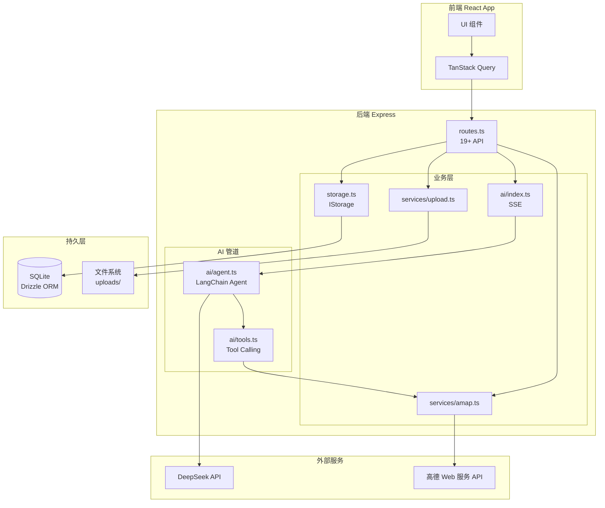

# 01. 架构总览

## 技术栈

| 层级 | 技术 | 版本 | 职责 |
|------|------|------|------|
| 运行时 | Node.js | 20+ | 服务端运行时 |
| Web 框架 | Express | 5.0 | HTTP 路由/中间件 |
| 语言 | TypeScript | 5.6 | 类型系统 |
| 开发工具 | tsx (watch) | 4.20 | 热重载开发 |
| 生产打包 | esbuild | 0.25 | bundle 到 CJS |
| 数据库 | better-sqlite3 | 11.7 | 同步 SQLite 驱动 |
| ORM | Drizzle ORM | 0.39 | 类型安全的 SQL 查询 |
| Schema 校验 | Zod + drizzle-zod | 3.24 / 0.7 | 运行时数据校验 |
| AI 框架 | LangChain.js | 1.3 | Agent + Tool Calling |
| LLM | `@langchain/deepseek` | 1.0 | deepseek-chat 模型 |
| 地图服务 | 高德 Web 服务 API | v3/v5 | 地理编码/POI/天气/路线/静态地图 |
| 文件上传 | multer | 2.1 | 多图上传 |
| 会话 | express-session + memorystore | 1.18 / 1.6 | 内存 Session |

## 目录结构

```
app/backed/
├── .env                          # 环境变量 (不提交)
├── package.json                  # 依赖 + 脚本
├── tsconfig.json                 # TS 配置
├── drizzle.config.ts             # Drizzle 迁移配置
│
├── shared/
│   └── schema.ts                 # 前后端共享的数据表定义
│
├── server/                       # 后端业务代码
│   ├── index.ts                  # Express 入口
│   ├── routes.ts                 # 路由注册
│   ├── db.ts                     # Drizzle + better-sqlite3 初始化
│   ├── storage.ts                # IStorage 接口 + DatabaseStorage 实现
│   ├── services/
│   │   ├── amap.ts               # 高德 API 封装
│   │   └── upload.ts             # multer 上传
│   └── ai/
│       ├── tools.ts              # LangChain Tools (3 个)
│       ├── agent.ts              # Agent 主循环 + 结构化输出
│       └── index.ts              # SSE 流式生成入口
│
├── script/
│   └── build.ts                  # esbuild 生产构建
│
├── scripts/                      # 验证脚本 (Phase 1) + 测试脚本 (Phase 2)
│   ├── verify-amap.ts
│   ├── verify-deepseek.ts
│   ├── verify-agent.ts
│   ├── verify-db.ts
│   ├── verify-upload.ts
│   ├── test-api.ts
│   └── test-ai-sse.ts
│
├── data/                         # 运行时数据 (不提交)
│   ├── sqlite.db                 # SQLite 数据库
│   └── uploads/                  # 上传的图片
│
└── doc/                          # 本规范文档
    ├── README.md
    ├── 01~06-*.md
    └── contracts/                # 原始数据契约 JSON
```

## 系统架构图



## 请求处理流程

### REST 类请求
```
Client
  └─► Express.json() 解析 body
      └─► session / CORS 中间件
          └─► 路由 handler
              └─► Zod 校验 (insertXxxSchema)
                  └─► storage.xxx() → Drizzle → SQLite
                      └─► JSON 响应
```

### AI 行程生成 (SSE)
```
Client POST /api/ai/generate-itinerary
  └─► streamItinerary()
      └─► 写入 SSE headers
          └─► runAgent() [最多 8 轮]
              ├─► ChatDeepSeek.invoke() → tool_calls
              ├─► 工具执行 (POI/天气/路线) → 高德 API
              └─► 迭代直到模型返回 final
          └─► structurize() → Zod schema
              └─► 逐节点 SSE 推送 {type:"node", node, index, total}
          └─► {type:"done"}
```

### 图片上传 + 打卡
```
Client POST /api/upload (multipart/form-data)
  └─► multer.array("photos", 9)
      └─► 写入 data/uploads/{timestamp}-{random}.ext
          └─► 返回 { urls: ["/uploads/..."] }

Client POST /api/checkins { nodeId, tripId, photos:[urls], caption }
  └─► Zod 校验
      └─► storage.createCheckin()
          └─► 返回 Checkin 实体
```

## 模块依赖关系

```
server/index.ts
  ├─► server/db.ts          (初始化)
  ├─► server/routes.ts      (业务路由)
  └─► server/services/upload.ts  (静态目录挂载)

server/routes.ts
  ├─► server/storage.ts     ← server/db.ts
  ├─► server/services/amap.ts
  ├─► server/services/upload.ts
  ├─► server/ai/index.ts
  └─► shared/schema.ts      (Zod Schema)

server/ai/index.ts
  └─► server/ai/agent.ts
      ├─► server/ai/tools.ts
      │   └─► server/services/amap.ts
      └─► @langchain/deepseek
```

## 关键架构决策

### 1. 采用同步 SQLite 驱动 (better-sqlite3)
- **原因**：单机部署、零配置、同步 API 简化业务代码
- **权衡**：不适合高并发；如规模扩大可替换为 `@libsql/client`（同 Drizzle 方言）

### 2. IStorage 抽象
- 数据访问统一通过 `IStorage` 接口
- 未来可无痛替换为 PostgreSQL / Supabase / 内存 Mock

### 3. SSE 而非 WebSocket
- 行程生成是单向流式推送，SSE 实现更轻量
- 浏览器原生支持，无额外依赖

### 4. 后端代理高德请求
- 所有高德请求必须经后端，避免 `AMAP_KEY` 泄漏
- 同时可对响应做裁剪 (减少前端数据量)

### 5. Zod Schema 双端共享
- `shared/schema.ts` 被前后端同时引用
- 前端 TypeScript 类型与后端数据保证一致

### 6. LangChain Agent 手动循环
- 未使用 `createReactAgent`，而是自己控制 `while` 循环
- 方便在每次迭代中向客户端推送 `tool_call`/`tool_result` 事件
- 可精确控制最大迭代次数 (防止无限调用)
